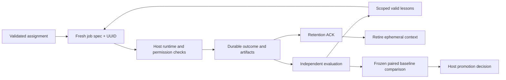

# Adaptive Agents


**A fresh agent for each job, with evidence that outlives the agent.**

[Quickstart](#quickstart) · [Architecture](#architecture) · [Integration](docs/INTEGRATION.md) · [Mathematics](docs/MATHEMATICS.md) · [Contracts](docs/event.schema.json) · [Test evidence](docs/TEST-RESULTS.txt) · [Changelog](CHANGELOG.md)

Adaptive Agents creates a job-specific name, role, context and unique instance identity. A host runs the assignment under its existing permissions and budgets. Outcomes and independently evaluated evidence enter an append-only graph; only scoped, valid lessons can inform future agents. The ephemeral context retires after durable evidence retention is acknowledged.

This is a portable lifecycle library, not an autonomous superagent. It invokes no models, executes no shell commands and grants no tool permissions. Any-harness support is an adapter design goal, not a compatibility certification.

## Quickstart

Python 3.10+ is the only runtime requirement. From this repository, no installation is needed:

```sh
python -m unittest discover -s tests -v
python -m adaptive_agents demo --db demo.sqlite
python -m adaptive_agents export --db demo.sqlite
python -m examples.benchmark
```

The demo is synthetic and explicitly unverified. The export includes private journal payloads; do not publish a real runtime database or export. For CopyRun, use `Store.export_structure(instance_id, limit=100)` and apply host privacy policy to identifiers too.

Optional package installation uses setuptools, a build-time tool, and no runtime dependencies:

```sh
python -m pip install --no-build-isolation .
```

### A concrete assignment

```python
from adaptive_agents import Assignment, Lifecycle, Store

store = Store("local-private.sqlite")
life = Lifecycle(store)
spec = life.allocate(Assignment(
    assignment_id="check-42", project_id="project-a",
    job_name="Migration Contract Auditor",
    objective="Check migration compatibility against the approved fixture suite",
    role="Inspect schema boundaries and report exact failing cases",
    context="Only the current approved assignment context",
    requested_tools=("read_project", "run_approved_tests"),
    lesson_keys=("migration-schema",), max_steps=12, timeout_seconds=120,
    copy_run={"run_id": "host-run-42", "root_run_id": "host-root-7"},
))
instance = spec["instance_id"]
life.transition(instance, "running", operation_id="start-42")
# Host starts the real worker and enforces permissions and a hard deadline.
# Call life.step(instance) before each bounded action.
life.transition(instance, "completed", summary="Example only; no verification",
                operation_id="finish-42")
# Host confirms all outcome evidence is retained before acknowledging retirement.
life.retire(instance, retention_ack="host-retention-receipt-42")
store.close()
```

A completion record is not proof of correctness. Real verification must name an authorized independent evaluator and bind an outcome event with artifact references and SHA-256 digests. The host must recheck those artifacts; the library does not read arbitrary paths or authenticate a caller's claim.

## Architecture



| Component | Responsibility |
|---|---|
| `core.py` | Assignment validation, fresh identity, lifecycle, event journal, graph and lesson retrieval |
| `adapters.py` | Host protocol and bounded same-assignment internal messages |
| `feedback.py` | Verified credited utility, revision-aware paired trials and baseline fallback |
| `examples/benchmark.py` | Deterministic no-model baseline/candidate fixture comparison |
| Host | Tool discovery, current authorization, process isolation, hard timeout, verification, artifact retention and context disposal |

All connected tools may be discovered and requested through the host. Requested tools are hints, not fixed-role restrictions. The host evaluates every action against current authority. Peer messages carry data and provenance, never authority; external communications need ordinary host permission.

## Evidence and feedback

Each allocation has a new UUID and unique job-derived display name. Stable job labels and candidate versions remain separate from ephemeral identity. No old transcript is silently reused. Lesson selection defaults to exact project and key matches, includes provenance, excludes revoked verification, and has a maximum 30-day validity period.

Feedback records unknown outcomes distinctly from verified failure. Missing costs block promotion. An identical trial retry contributes once; an explicit next revision replaces its contribution while preserving the earlier evidence. The finite-suite gate requires complete, current, correctly scoped paired cases, independent evidence, safety checks, positive mean gain, and no case below the configured regression tolerance. It returns a recommendation; hosts decide whether to deploy.

The supplied synthetic benchmark compares a fixed no-memory required-field check with a scoped validated required-field recipe. An equal-capability no-memory baseline also checks the declared schema directly; it matches correctness at lower declared cost and the gate retains that baseline. These results demonstrate the machinery on deliberately constructed cases. They do not measure LLM quality, establish statistical superiority, or promise improvement on each run. See [mathematics and falsifiable limits](docs/MATHEMATICS.md).

## Retention, privacy and limits

- Objective and raw context are excluded from the journal. Role, names, tool IDs, summaries, lesson text, messages and evidence references persist: redact them **before** calling the API. The library cannot reliably detect secrets.
- Journal rows cannot be updated/deleted through its schema triggers. This is not tamper-proof against a database owner. Protect the database and artifact store with host access controls and backups.
- Retirement drops only this library's context reference after a host retention ACK. It cannot erase other copies, provider history or Python heap remnants. It never deletes evidence.
- One serial host controller must own each instance and feedback scope. Multiple SQLite transition writers are serialized; arbitrary concurrent calls are not a supported orchestration strategy.
- Events are capped at 64 KiB; lesson retrieval returns up to 32 entries, default 8. Internal messages are at most 2,000 characters, 32 by default per sender and inbox, and consume a step. Structural export is capped at 1,000 events. v0.1 scans journal history in memory; large deployments need indexed retrieval and archival policy.
- Budgets are cooperative checkpoints. Hosts must enforce wall-clock interruption and reconcile crashed workers. Recovered private contexts never replay automatically.
- No live harness, model, OS sandbox or Pegasus UI integration is certified by these offline tests. Full retention scheduling, signed remote attestations, semantic privacy filtering and automated production rollout are deferred.

## Development and licensing

All source and SVG artwork were created for this standalone project. No Pegasus source, runtime records, private logs or credentials are included. Runtime dependencies: none. Optional build dependency: setuptools (MIT). Project license: [MIT](LICENSE).

For coding agents and maintainers, read [AGENTS.md](AGENTS.md) before changing contracts.
